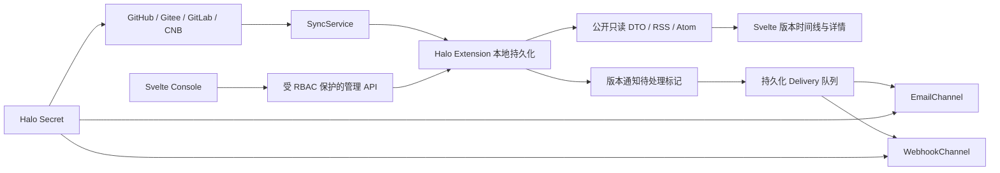

# Release Hub 架构与开发计划

## 基线与边界

- 在现有官方脚手架上开发，目标为 **Halo >= 2.27.0、Java 21**。不声称兼容旧版 Halo 的内部 API。
- 后端使用 Halo Extension、Secret、Setting、ReactiveExtensionClient、CustomEndpoint、ReverseProxy 与主题模板机制；不引入外部数据库。
- Console 和前台的实际界面均使用 **Svelte 5**。Console 仅有一个 Vue 组件负责挂载、卸载 Svelte，适配 Halo 的 Vue 路由契约。
- 使用 Halo UI 官方打包预设，Console 请求复用 `axiosInstance`；API 类型与客户端由 `generateApiClient` 根据实际 Halo OpenAPI 生成。

## 模块

| 目录 | 职责 |
| --- | --- |
| `model/` | 持久化模型和基础存储操作 |
| `provider/` | 平台认证、分页与平台响应归一化 |
| `account/` | 平台账号验证、仓库目录适配、账号凭据引用与批量导入 |
| `halo/` | Halo 插件/主题清单安全解析、名称发现与缓存策略 |
| `sync/` | 同步、租约、失败退避和插件生命周期内的后台任务 |
| `subscription/` | 订阅范围、双重确认、退订和渠道配置 |
| `notification/` | 通知展开、持久化发送队列和渠道实现 |
| `security/` | Secret、签名令牌、限流和出站网络边界 |
| `content/`、`feed/` | Markdown 清洗与标准 XML Feed |
| `web/` | 公开/管理 API、OpenAPI、Feed 端点、用户发布页面链接与主题组件加载器 |
| `ui/src/editor/` | 默认编辑器工具箱/斜杠命令、组件序列化与 Svelte 项目配置卡片 |
| `ui/src/frontend/` | 公开 Svelte 页面和订阅交互 |
| `ui/src/console/` | Svelte 管理页面及最小 Vue 桥接 |
| `ui/src/api/generated/` | 自动生成，禁止手动维护 |

## 数据模型

| Halo Kind | 关键数据与约束 |
| --- | --- |
| `ReleaseProject` | 仓库、平台、排序、启停、频率、Secret 引用；同步状态含租约、ETag、最后成功时间及下次尝试时间 |
| `RepositoryAccount` | 平台、站点、显示名、Token Secret 引用与验证得到的用户 ID/用户名；对 Console 仅返回脱敏 DTO |
| `HubRelease` | 仓库、平台 ID、Tag、标题、Markdown、安全 HTML、摘要、时间、预发布和附件；`仓库 + Tag` 派生唯一名称 |
| `HubSubscription` | EMAIL / WEBHOOK、项目集合、预发布范围、验证/启停状态、令牌世代；匿名接口不返回该模型 |
| `HubDelivery` | 订阅、版本、VERIFY / RELEASE / TEST、状态、尝试次数、发送租约和下次尝试时间 |
| `HubSyncLog` | 开始/结束、初次导入标识、导入数量、结果和脱敏错误 |

凭据只存 Halo Secret。资源中仅保存 Secret 名称；账号与手动仓库的 Token 通过宿主注册的 FormKit `secret` 组件选择、创建和编辑，业务接口只接收引用。新增引用前根据当前认证的角色依赖核对该 Secret 的 `get` 权限，后端校验固定 `token` 字段存在、非空且格式有效。签名根密钥在首次使用时生成并持久化，插件重启后令牌仍可验证。Secret 不会因停用插件被删除。

仓库可引用账号，也可保留原来的独立 Secret。每次同步读取当前 Secret，密钥更新会作用于所有关联仓库；缺失账号或凭据时同步失败，不降级为匿名访问。账号删除前检查引用，仍有关联仓库时拒绝删除；解除关联后删除账号仍保留用户管理的共享 Secret。创建/更新账号通过平台身份接口验证，替换 Secret 时拒绝无意切换到其他远端用户。

Console 的 Svelte 页面通过显式上下文接口挂载 Halo 已注册的 FormKit Secret 和官方 VModal，沿用宿主的 Vue appContext、查询客户端、权限和国际化。Svelte 继续管理业务表单与状态，宿主组件负责 Secret 的选择/管理流程；Console 采用官方弹窗避免原生 dialog 顶层遮挡 Secret 子弹窗。公开前台保持独立 Svelte 和原生 dialog，不依赖 Vue 宿主。

仓库发现采用独立 `RepositoryCatalog` 接口，不与 Release 解析耦合。四个平台分别适配身份、分页列表和单仓库查询；查询页仅返回安全仓库元数据。批量导入最多 50 个、平台请求并发为 2，重新读取所选仓库后再创建，并使用当前仓库归一化地址判重。逐项结果支持部分失败重试；现有记录保留各自启停、凭据和同步状态，不被导入覆盖。

`GitHubApi` 统一处理账号/仓库/版本 API 和代理设置。配置的根地址替换 GitHub API origin，可带路径前缀，认证头仅向此显式配置的受信任目标发送；原有 DNS/HTTPS/无重定向限制仍有效。Gitee、GitLab、CNB 不经过此层。设置读取失败或代理不可用时不回退到其他目标；浏览器链接与 Release 附件保持原平台 URL。

## 同步与幂等

1. 每 10 秒检查到期仓库，同步并发最多 2；管理员手动同步通过更新下次同步时间进入同一流程。
2. 仓库资源上的 10 分钟租约与进程内锁防止重入，单次同步最多 8 分钟。Halo 的资源版本控制处理并发修改。
3. GitHub 使用 ETag 条件请求。其他平台按官方分页完整拉取，在本地比较归一化字段，只新增或更新发生变化的记录，不假设平台存在 `updated_since` 等参数。
4. 首次导入完全成功前，所有新建版本都保持静默；部分导入失败后仍按首次导入继续，避免重试造成历史通知。
5. 后续新增版本记录携带持久化待通知标记。通知展开还需确认仓库最后成功同步时间不早于版本发现时间，失败的部分同步不会提前发信。
6. 以 `仓库 + Tag` 去重；同一个 Tag 的内容更新不重复通知。GitHub 重建远端 Release ID 也不会生成第二条版本。
7. 限流遵循 `Retry-After` / `X-RateLimit-Reset`，其他失败指数退避；网络请求有连接、响应、总时限及 4 MiB 响应体边界。

后台同步与通知有独立运行状态，慢速平台不会阻塞邮箱验证。停止插件时取消任务和定时器，租约到期后可恢复未完成工作。

## 订阅和发送语义

- RSS/Atom 无需登录；全站或项目范围，默认仅正式版，可显式包含预发布，最多返回最近 50 个版本。
- 邮件必须二次确认，验证令牌有效期 24 小时。邮件中的取消链接先展示确认页，显式 POST 后退订，避免邮件扫描器误操作。
- 邮件 API 限制来源请求频率和邮箱请求频率，重复请求返回中性结果。退订会轮换令牌世代，旧链接不能影响后来重新建立的订阅。
- 通知仅匹配在版本发现前已经验证、处于启用状态的订阅。发送前再次核对订阅状态、范围、预发布偏好及项目状态。
- 每个 `版本 + 订阅` 对应唯一 Delivery。展开中途崩溃可重入，已创建的任务不会重复插入。
- 发送状态为 `QUEUED → SENDING → SENT`，失败为 `RETRY`，最多尝试 5 次后为 `FAILED`。管理员可重新入队失败任务。
- 发送租约有效期 120 秒，任务执行时限 75 秒；重启后恢复过期的 SENDING 任务。
- 对远端系统提供**至少一次投递**，不能承诺跨邮件服务/HTTP 的分布式 exactly-once：远端已接受、插件尚未写入成功状态时崩溃，可能再次投递。Webhook 接收方须按稳定事件 ID 去重；邮件的 MIME 与 Message-ID 由 Halo 内置通知器负责。

## 安全边界

- 公开接口仅返回 ProjectView / ReleaseView / PublicSettings，不包含邮箱、访问令牌、SMTP 设置和内部任务。
- 公开 RBAC 仅授予列举项目/版本/公开配置以及受限的订阅操作，不开放自定义模型 CRUD 或 Secret。
- 管理权限通过独立 `console.api.release-hub.xhhao.com` 组和角色模板分配。
- Markdown 原始 HTML 转义，渲染后再经 Jsoup 清洗；移除图片以避免追踪像素，链接仅保留安全协议。
- 出站 API 与 Webhook 只接受 HTTPS/443，拒绝 userinfo、片段和本地主机名。DNS 在 boundedElastic 隔离解析，检查全部解析结果并将验证过的地址交给实际连接，拒绝私网、回环、链路本地、CGNAT、IPv6 过渡地址，禁止自动重定向。
- 平台 Token 仅用于对应平台；GitHub、Gitee、CNB 使用固定 API 域名。GitLab 可连接公网自建实例，不支持本地私网实例。
- Gitee 按官方规范将 `access_token` 放在查询串，因此不能记录完整请求 URI。日志仅保存 HTTP 状态或异常类别。
- 邮件发送复用 Halo 2.27 内置 `ReactiveNotifier`，系统通知设置是唯一发件配置来源；插件不再实现 SMTP 传输。`HaloEmailSender` 通过共享 `ExtensionGetter` 找到已启用的原生邮件通知器，并按目标版本 `DefaultNotifierConfigStore` 的布局只读加载系统 Secret。未配置/停用时明确失败，不记录为已发送；原生发送结果继续驱动插件的持久化重试。匿名邮箱使用 Halo `UserIdentity`，原生邮件页脚使用插件的安全退订链接。
- 邮件确认与退订在用户发布的组件页面处理。主题头部在资源之前插入 `referrer=no-referrer` 和 `robots=noindex, nofollow` 元数据，成功后移除当前页面 URL 的令牌。

## 开发顺序与交付

1. 检查现有脚手架、Halo 2.27 SDK 和官方文档，记录 API 契约。
2. 建立模型、Secret、出站网络边界和模块接口。
3. 完成 GitHub 同步、去重和版本展示；接入其余三个 Provider。
4. 实现 RSS/Atom、邮件确认与退订、Webhook 和持久化通知队列。
5. 完成 Svelte 前台、Console、Setting 与角色模板。
6. 运行协议解析、安全和跨重启工作流测试；实际 Halo 安装、资源、API、权限及浏览器验收；构建可安装 JAR。

## 已核对的官方契约

核对日期：2026-11-03。平台文档/Schema 的真实字段优先于通用字段假设。

| 来源 | 已核对内容 |
| --- | --- |
| [Halo 插件开发](https://docs.halo.run/developer-guide/plugin/index.md) | 官方插件开发入口 |
| [Halo API 变更](https://docs.halo.run/developer-guide/plugin/api-changelog.md) | 2.27 SDK、Spring Boot 4 与 UI ESM 打包 |
| [Extension](https://docs.halo.run/developer-guide/plugin/api-reference/server/extension.md) / [ExtensionClient](https://docs.halo.run/developer-guide/plugin/api-reference/server/extension-client.md) | GVK、唯一 metadata.name、响应式 CRUD 与资源版本 |
| [自定义端点](https://docs.halo.run/developer-guide/plugin/api-reference/server/custom-endpoints.md) / [生成客户端](https://docs.halo.run/developer-guide/plugin/basics/devtools.md) | CustomEndpoint、SpringdocRouteBuilder、generateApiClient |
| [敏感数据与出站请求](https://docs.halo.run/developer-guide/plugin/security/outbound-http.md) | Secret、DNS/SSRF、重定向边界 |
| [主题模板](https://docs.halo.run/developer-guide/plugin/api-reference/server/template-for-theme.md) / [ReverseProxy](https://docs.halo.run/developer-guide/plugin/api-reference/server/reverseproxy.md) | 主题覆盖、layout 契约和静态资源注册 |
| [GitHub Releases API](https://docs.github.com/en/rest/releases/releases#list-releases) | `GET /repos/{owner}/{repo}/releases`，Bearer、分页、draft、prerelease 和 assets |
| [Gitee API](https://gitee.com/api/v5/swagger) / [官方运行时 Schema](https://gitee.com/api/v5/doc_json) | `/v5/repos/{owner}/{repo}/releases`，access_token、page/per_page/direction、created_at、字符串附件数组 |
| [GitLab Releases API](https://docs.gitlab.com/api/releases/) / [官方文档源码](https://github.com/gitlabhq/gitlabhq/blob/master/doc/api/releases/_index.md) | URL 编码项目路径、PRIVATE-TOKEN、released_at、assets.links；无通用 prerelease 布尔字段 |
| [CNB OpenAPI](https://api.cnb.cool/) / [官方 Swagger](https://api.cnb.cool/swagger.json) | `/{repo}/-/releases`，BearerAuth、page_size、CNB Accept 头、`api.Release` 和 `api.ReleaseAsset` |
| [GitHub 账号](https://docs.github.com/en/rest/users/users#get-the-authenticated-user) / [账号仓库](https://docs.github.com/en/rest/repos/repos#list-repositories-for-the-authenticated-user) | `/user` 与 `/user/repos`，分页、所有者/协作/组织权限范围 |
| [GitLab Users](https://docs.gitlab.com/api/users/#get-the-current-user) / [Projects](https://docs.gitlab.com/api/projects/#list-all-projects) | `/user`，`membership=true`，`path_with_namespace` 与可见性 |
| [Gitee 运行时 Schema](https://gitee.com/api/v5/doc_json) | `/v5/user`、`/v5/user/repos` 与 `/v5/repos/{owner}/{repo}`，以 `html_url` 提取真实路径，不使用可能翻译的显示名称 |
| [CNB 访问令牌](https://docs.cnb.cool/zh/guide/access-token.html) / [Swagger](https://api.cnb.cool/swagger.json) | `/user`、`/user/repos`、`/{repo}`，`role=Guest`、50 条分页，`visibility_level` 为 `Public/Private/Secret`，归档状态为整数 1 |
| [Halo 插件清单](https://docs.halo.run/developer-guide/plugin/basics/manifest) / [主题配置](https://docs.halo.run/developer-guide/theme/config) | `Plugin` / `Theme` 的 apiVersion、kind 与显示名称 `spec.displayName` |
| [GitHub Contents](https://docs.github.com/en/rest/repos/contents#get-repository-content) / [GitLab Files](https://docs.gitlab.com/api/repository_files/) | 默认分支文件的 Base64 内容，GitLab `ref=HEAD` 与文件路径编码 |
| [Gitee Schema](https://gitee.com/api/v5/doc_json) / [CNB Schema](https://api.cnb.cool/swagger.json) | Gitee `/contents/{path}`、CNB `/-/git/contents/{file_path}`，Base64 编码与 CNB `repo-code:r` 权限 |

Halo 名称发现只查询六个固定清单路径，单文件限制为 64 KiB；不跟随下载、符号链接或 LFS URL。使用 SnakeYAML SafeConstructor，限制 YAML 深度、别名和重复键，仅接受对应的 Halo GVK 与有效显示名称。识别结果存入项目 status，不覆盖 spec 的备用名称；名称解析集中在 Project.displayName()。24 小时缓存包含正常未匹配结果，暂时错误保留此前识别值并在下次同步重试。即使 Release API 返回 304，也会执行到期的名称发现。

GitLab 预发布由版本标签推断；不能把 GitHub 的 `prerelease` 字段套用到 GitLab。GitLab 未来计划发布时间的版本不提前展示。
